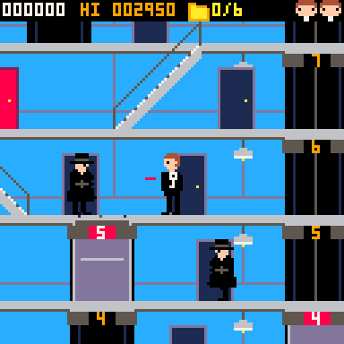
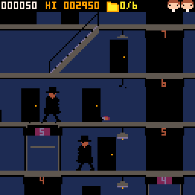

# Secret Agent Man

Jogo arcade de espionagem para **PICO-8**: um agente secreto britânico de smoking invade um prédio, desce por elevadores e escadas rolantes, entra nas portas vermelhas para roubar os planos secretos, enfrenta os agentes de capote e foge de carro.

  

## Jogar
- **PICO-8:** `load secretagentman.p8` e `run`
- **Navegador:** abra `web/index.html`

**Controles:** ⬅️➡️ andar · ⬆️⬇️ elevador / escada rolante / porta vermelha (⬆️) / abaixar (⬇️) · **Z** atirar · **X** pular (pule e atire nos lustres para apagar a luz do andar).

## Desenvolvimento
As fontes ficam em [`fontes/`](fontes/) (Lua, sprites em ASCII, áudio). Para gerar o cartucho:

```
python tools/build.py
```

Detalhes do que foi implementado e próximos passos: [RELATORIO.md](RELATORIO.md). Design original: [conceitos.md](conceitos.md).
