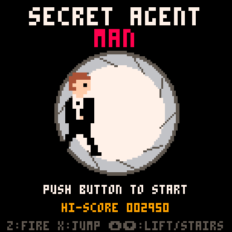
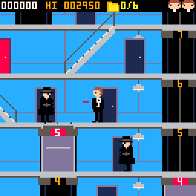
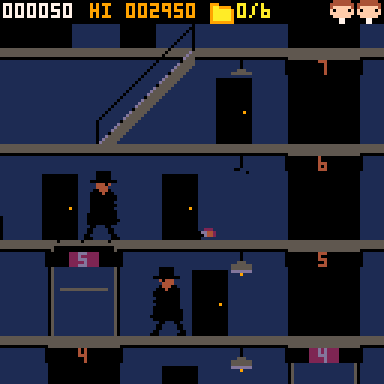

# Secret Agent Man — Relatório de desenvolvimento

Jogo arcade para **PICO-8** feito a partir de [conceitos.md](conceitos.md) e da imagem `tilesets concepts.jfif`.

- Cartucho: [secretagentman.p8](secretagentman.p8) (abre no PICO-8: `load secretagentman.p8` → `run`)
- Versão web: [web/index.html](web/index.html) (exportada pelo próprio PICO-8; abre no navegador)
- Fontes editáveis: pasta [fontes/](fontes/) — o cartucho é **gerado** a partir dela por `python tools/build.py`

  

---

## 1. O que foi implementado

### Tela inicial
- Título "SECRET AGENT / MAN" em fonte larga.
- Abertura no estilo *gun barrel*: bolinhas brancas atravessam a tela, a última vira o cano da arma (círculo com raias girando), o agente entra andando, vira de frente apontando o revólver para o jogador — **quebrando a quarta parede** — e dispara (clarão + som).
- "PUSH BUTTON TO START" piscando; ao apertar, a mensagem pisca rápido por 1 s e o jogo começa.
- Mostra o hi-score salvo (persistente via `cartdata`).

### Jogo
| Elemento | Como ficou |
|---|---|
| **Prédio** | Telhado + 12 andares (256 px de largura × 416 px de altura), scroll horizontal e vertical com câmera suave. HUD fixo no topo. |
| **Entrada** | Sequência especial do concept: o agente desce de **paraquedas** (canopy com a bandeira britânica) até o telhado. |
| **Elevadores** | 4 poços com faixas de andares diferentes (1–5, 3–8, 5–10, 8–12), obrigando a combinar elevadores e escadas. Fora do controle do jogador, a cabine anda sozinha entre andares aleatórios. **Dentro** dela o jogador controla com ⬆️/⬇️ (para em cada andar, continua se o botão estiver segurado). Dá para **subir no teto** da cabine quando ele está nivelado com o andar. Placas acima de cada porta de elevador mostram o número do andar e acendem em vermelho quando a cabine está ali. |
| **Queda no poço** | Entrar no poço sem a cabine faz cair; queda de mais de ~1 andar (40 px) **mata**. |
| **Esmagamento** | Quem está no teto da cabine é esmagado ao chegar no topo do poço; quem está no fundo do poço (andar mais baixo) é esmagado pela cabine descendo. |
| **Escadas rolantes** | 7 escadas ligando pares de andares (inclusive telhado → 12º). ⬇️ no topo desce, ⬆️ na base sobe. |
| **Portas vermelhas** | 6 portas com os planos. ⬆️ em frente: a porta abre, o agente entra, a porta fecha (nunca se vê a sala), abre de novo e ele sai com os planos. A porta passa a ser azul como as outras. |
| **Inimigos** | Agentes de chapéu e capote pretos saem das portas azuis perto do jogador. Seguem **as mesmas regras de movimento** (código compartilhado `act()`): usam elevadores (por dentro e pelo teto), escadas rolantes, caem nos poços e são esmagados. A maioria evita poço aberto, mas ~15% são "descuidados". Atiram quando estão no mesmo andar e a uma distância de até 100 px (40 px no escuro). |
| **Tiros e abaixar** | Os tiros dos inimigos saem na altura do peito; **abaixado** (⬇️), o jogador fica com 12 px de altura e os tiros passam por cima. Os inimigos não se abaixam. |
| **Lustres** | Dois por andar. O tiro normal passa por baixo; **pulando e atirando**, o tiro acerta o lustre, que quebra e **apaga a luz do andar**. |
| **Escuridão** | Andar sem luz é desenhado com uma paleta escura (cenário **e** sprites, por remapeamento de cores na memória de vídeo). Se o jogador está num andar escuro, a tela inteira fica escura; ao chegar num andar iluminado, volta ao normal. |
| **HUD** | Placar, hi-score, ícone de pasta com planos coletados (x/6) e vidas como cabeças do agente. |
| **Fim da fase** | Com todos os planos: "ALL PLANS! ESCAPE VIA LOBBY!". No térreo, a saída à direita (antes bloqueada) libera; o agente sai para a rua, entra na **caranga verde** e vai embora acelerando. "MISSION COMPLETE!" + bônus de 1000 × nível. |
| **Progressão** | Cada missão seguinte aumenta a velocidade, o número máximo e a cadência de tiro dos inimigos. 3 vidas; game over volta para a tela inicial. |

**Controles:** ⬅️➡️ andar · ⬇️ abaixar / descer escada / descer elevador · ⬆️ entrar na porta vermelha / subir escada / subir elevador · **Z (🅾️)** atirar · **X (❎)** pular. No menu de pausa (Enter) há a opção "music on/off".

**Pontuação:** inimigo baleado 100 · inimigo esmagado/caído 300 · planos 500 · lustre 50 · bônus de missão 1000 × nível.

### Música e sons
- **Tema original** no estilo surf/espionagem dos anos 60: baixo em ostinato de blues em Mi (com a 5ª diminuta, típico do gênero), bateria surf (bumbo, caixa, chimbal) e guitarra solo em onda *pulse* com vibrato, além de um trecho de *tremolo picking* de surf. Estrutura: intro → tema → break de tremolo → IV grau → tema → turnaround com virada de caixa, em loop. Usa 3 canais; o 4º fica livre para os efeitos. A composição é original (não copia as melodias de Secret Agent Man, Peter Gunn nem do tema de Bond).
- 14 efeitos: tiro do jogador/inimigo, inimigo abatido, morte, coleta de planos, vidro do lustre, "ding" do elevador, pulo, start, esmagamento, motor do carro, jingle de missão, porta e game over.

### Arte (adaptação do concept para o PICO-8)
- Personagens em sprites **16×24** (2×3 tiles), grandes como pedia o concept, aproveitando o scroll. Estilo flat, poucas cores: smoking preto com camisa branca e gravata-borboleta, cabelo castanho; inimigos com chapéu de aba e faixa cinza, óculos escuros, capote com cinto.
- Quadros do agente: parado, 2 de caminhada, tiro, abaixado, tiro abaixado, pulo, tiro no pulo, morto e **de frente apontando** (usado em 2× na abertura). Inimigos: parado, 2 de caminhada, tiro e morto.
- Ícone de vida, pasta dos planos, canopy do paraquedas e carro (32×16).
- O prédio (paredes azuis, lajes cinza, portas azuis/vermelhas com batente, poços, cabines lilás, lustres, escadas rolantes, telhado com antena, casa de máquinas e casinha da escada, rua com calçada e skyline) é **desenhado por código** em vez de tiles do mapa. Assim sobra a sprite sheet inteira para os personagens e o prédio pode ser mais largo/alto do que caberia no mapa.
- A versão "escura" dos tiles e sprites vem de uma tabela de cores (`dm`) aplicada às linhas da tela dos andares apagados, o que dispensa uma segunda cópia dos sprites.

---

## 2. Estrutura dos arquivos

```
secretagentman.p8          cartucho final (gerado)
web/index.html, index.js   versão jogável no navegador (gerada pelo PICO-8)
fontes/
  lua/game.lua             todo o código do jogo (~4.900 de 8.192 tokens)
  sprites/player.txt       sprites do agente (pixel art em ASCII)
  sprites/enemy.txt        sprites dos inimigos
  sprites/items.txt        vida, pasta, paraquedas, carro
  sprites/spritesheet.png  prévia da sprite sheet (gerada a cada build)
  audio/audio.py           efeitos sonoros e música (notas em texto)
  label.txt                imagem do label do cartucho
tools/build.py             monta o .p8 a partir de fontes/
docs/screenshots/          capturas
```

**Fluxo de edição:** editar `fontes/...` → `python tools/build.py` → abrir `secretagentman.p8` no PICO-8. Para refazer a versão web: `pico8 -x secretagentman.p8 -export web/index.html`.

Nos `.txt` de sprites, cada bloco começa com `@ x y nome` (posição na sheet 128×128); `.` é transparente e `0`–`f` são as cores do PICO-8. Atenção: se você editar sprites **dentro** do editor do PICO-8 e salvar, as mudanças ficam só no `.p8` e serão sobrescritas no próximo build. Edite pelos `.txt` ou copie as mudanças de volta.

## 3. Como foi testado
- Execução *headless* do PICO-8 (`pico8 -x`) com um script que simula o controle: tela inicial, paraquedas, escada rolante, elevador, inimigos, quebra de lustre, porta vermelha, fuga de carro e 3.000 frames de entradas aleatórias. Rodou **sem erros**, e as capturas da tela (em `docs/screenshots/`) foram conferidas visualmente.
- Bugs encontrados e corrigidos nesse processo: corpo flutuando quando o personagem morria dentro do elevador em movimento, skyline alto demais, texto de ajuda cortado e inimigos chegando ao telhado no exato momento do pouso (foi adicionado um tempo de carência).
- **Ainda não testado:** jogar de verdade com teclado/controle. O equilíbrio de dificuldade (velocidade dos inimigos, cadência dos tiros, frequência de surgimento) precisa ser ajustado jogando.

---

## 4. Implementações e alterações futuras

### Prioridade alta (jogabilidade)
1. **Balanceamento jogando de verdade:** cadência de tiro, velocidade dos inimigos e `spt` (intervalo de surgimento). Hoje os valores são estimativas.
2. **Invencibilidade breve ao renascer** (piscando por ~2 s) e renascer longe de inimigos.
3. **IA dos inimigos usando o elevador de propósito** para perseguir o jogador entre andares (hoje eles só usam quando passam por um, e as escadas só quando estão indo na direção do jogador).
4. **Inimigos que também se abaixam ou atiram baixo** em níveis mais altos, para o jogador não ficar seguro só abaixando (o concept diz que os inimigos não se abaixam; avaliar).
5. **Chute/ataque corpo a corpo** e pulo sobre inimigos, como alternativa ao tiro.
6. Tiros dos inimigos acertando lustres (apagões "acidentais").

### Conteúdo
7. **Vários prédios/layouts** por fase (hoje o layout é fixo, só a dificuldade muda). Dá para gerar o layout a partir de uma tabela por fase ou proceduralmente (o código já lê as listas `shafts`, `escs` e `doors`).
8. **Itens extras do concept:** relógio, colar, cartão de acesso, maleta, extintor e vasos de planta como decoração ou bônus de pontos; arma extra com mais munição.
9. **Placas de andar estilo concept** (28/27/26) em vez de 12…1, com prédios mais altos.
10. **Janelas com vista da cidade** e móveis (mesa, cofre, planta), como no tileset do concept, desenhados ao fundo.
11. Vida extra a cada 10.000 pontos.
12. Tela de ranking (top 5) usando mais slots do `cartdata`.

### Arte e animação
13. Animação de **queda** (braços para cima) e de **esmagamento** própria; inimigo caindo de costas com o chapéu voando.
14. Animação do agente **entrando no carro** e porta do carro abrindo; fumaça do escapamento.
15. Portas do elevador abrindo/fechando (hoje a cabine é aberta).
16. Brilho/cone de luz sob os lustres e cacos de vidro caindo ao quebrar.
17. Partículas de faísca no impacto das balas e cartucho ejetado.
18. Ilustração mais detalhada na abertura (efeito de sangue escorrendo/vinheta vermelha) e transição para o paraquedas.

### Som
19. Uma segunda música para o andar escuro (tensa, só baixo e chimbal) e um jingle curto de "mission complete" com a música completa.
20. Passos e som de escada rolante; som do motor do elevador em loop baixo.

### Técnico
21. Otimizar `darken()` (hoje faz `peek/poke` byte a byte; dá para usar `memcpy` com uma tela pré-escurecida ou `pal()` por região com `clip()`).
22. Suporte a 60 fps (`_update60`) ajustando velocidades.
23. Rodar o teste automatizado (`tools/test_harness.lua` + `tools/dump2png.py`, usados no desenvolvimento) num CI, com um script único que cole o harness no cartucho e gere as capturas.
24. Publicar a versão web via GitHub Pages (a pasta `web/` já está pronta).
